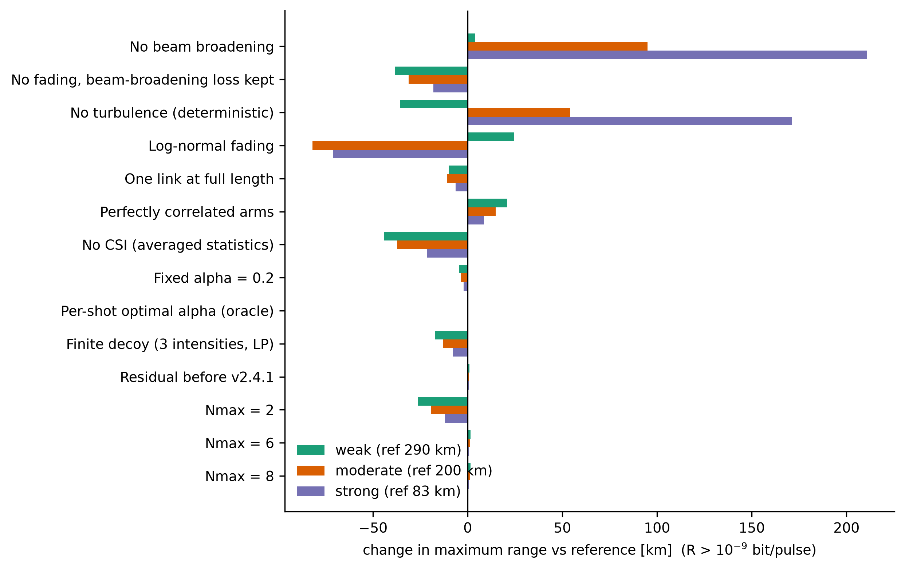
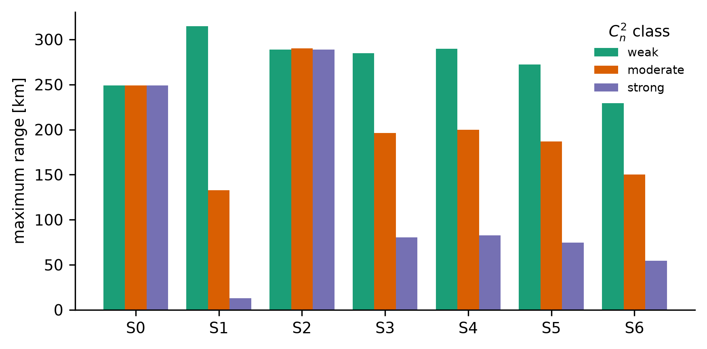
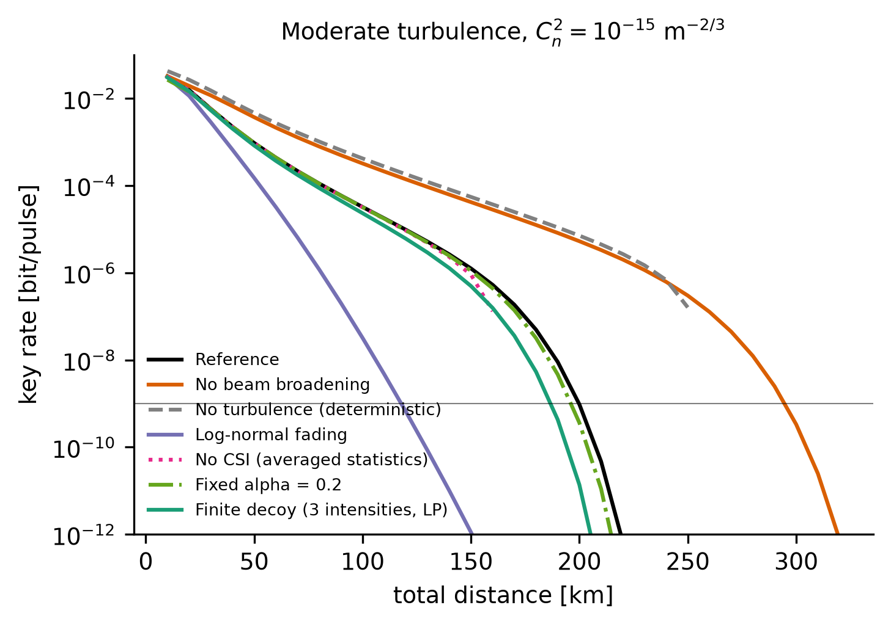

# Ablation study

`paper_analysis/ablation/` measures which parts of the Gamma-Gamma TF-QKD key-rate model matter. It changes one component of a
reference configuration at a time and reports the effect on the maximum range and on the key rate at fixed distances. A second,
cumulative "ladder" adds components one at a time to a deterministic baseline.

The study imports `src/` and `paper_analysis/gamma_gamma/lib.py` unchanged. It is deterministic (quadrature), so there are no random
seeds. The results of the full run are in `paper_analysis/ablation/results/` and summarised in section 4; section 5 reproduces them.

## 1. Reference configuration

Gamma-Gamma fading with long-term beam broadening, independent fading on each arm, CSI averaging, ergodic-optimal amplitude `alpha`,
infinite decoy, corrected residual (v2.4.1), `Nmax = 4`, `pd = 1e-7`, 150 quadrature nodes per arm. Turbulence classes are
`Cn2 = 1e-17 / 1e-15 / 1e-13` (weak / moderate / strong). The range is the largest total distance with a key rate above 1e-9
bit/pulse.

## 2. Variants

| group | variant | what changes |
|---|---|---|
| channel | no beam broadening | drops the mean-loss factor of `docs/BEAM_BROADENING.md` |
| channel | no fading, beam-broadening loss kept | deterministic channel with the broadened mean loss |
| channel | no turbulence | deterministic channel, no broadening |
| channel | log-normal fading | replaces Gamma-Gamma (`docs/LOGNORMAL.md`) |
| channel | one link at full length | one fading factor over the whole distance instead of two independent arms (`docs/TWO_LINK_FADING.md`); broadening is kept |
| channel | perfectly correlated arms | `eta = eta_arm^2` with one realisation on both arms; a what-if bound, not a physical claim |
| receiver | no CSI | key rate from averaged statistics only |
| receiver | fixed `alpha = 0.2` | instead of the ergodic optimum |
| receiver | per-shot optimal `alpha` | oracle upper bound that needs the instantaneous `eta` |
| security | finite decoy (D3, LP) | `docs/FINITE_DECOY.md` |
| security | residual before v2.4.1 | the square-set residual that the fix replaced |
| security | `Nmax = 2, 6, 8` | photon-number cut-off of the bound |
| numerics | 20 to 250 nodes per arm | convergence table at three operating points |

Ladder: S0 deterministic with `alpha = 0.2`, then add log-normal fading, switch to Gamma-Gamma, add beam broadening, add `alpha`
optimisation, add finite decoy, remove CSI.

## 3. Reading the results

- **Odd `Nmax` adds nothing.** The triangular sets use pairs with `nA + nB <= Nmax`, so `Nmax = 3` equals 2 and 5 equals 4. Only
  even values are listed.
- **`Nmax = 4` is close to converged.** The key rate does not decrease as `Nmax` grows, and the measured range gain from `Nmax = 6` and 8 is at most 1.5 km (section 4).
- Quadrature resolution: see the numerical-resolution paragraph in section 4. Range differences of a km or less are not resolved by the shipped results.
- Protocol parameters (`pd`, `theta`) are not ablated, because they are parameter sweeps rather than model components. The analytic
  expansion order is covered by `paper_analysis/gamma_gamma/results/tables/analytic_vs_quadrature.csv`.

## 4. Results

Full run, 45 range searches (15 variants, 3 classes) and 180 key-rate points. Tables and figures are in
`paper_analysis/ablation/results/` (`tables/ablation_ranges.csv`, `ablation_points.csv`, `ablation_ladder.csv`, `ablation_sweep.csv`,
`ablation_table.tex`; `figures/abl_F1` to `abl_F3`).

### One factor at a time

Maximum range in km for a key rate above 1e-9 bit/pulse, with the change against the reference in brackets. The last column is the
key rate relative to the reference at 150 km, moderate turbulence.

| variant | weak | moderate | strong | R / R_ref, moderate, 150 km |
|---|---:|---:|---:|---:|
| Reference | 289.5 | 199.8 | 82.7 | 1 |
| No beam broadening | 293.4 (+3.8) | 294.8 (+95.0) | 293.4 (+210.7) | 33.26 |
| No fading, beam-broadening loss kept | 251.0 (-38.5) | 168.7 (-31.2) | 64.6 (-18.0) | 1.31 |
| No turbulence (deterministic) | 254.0 (-35.5) | 254.0 (+54.2) | 254.0 (+171.4) | 43.74 |
| Log-normal fading | 314.1 (+24.6) | 117.9 (-81.9) | 11.7 (-70.9) | 0.00 |
| One link at full length | 279.6 (-10.0) | 188.9 (-10.9) | 76.2 (-6.5) | 1.13 |
| Perfectly correlated arms | 310.4 (+20.9) | 214.7 (+14.8) | 91.4 (+8.7) | 1.73 |
| No CSI (averaged statistics) | 245.3 (-44.2) | 162.4 (-37.4) | 61.3 (-21.4) | 0.72 |
| Fixed alpha = 0.2 | 284.9 (-4.6) | 196.4 (-3.5) | 80.5 (-2.2) | 0.89 |
| Per-shot optimal alpha (oracle) | 289.6 (+0.1) | 199.9 (+0.0) | 82.7 (+0.0) | 1.01 |
| Finite decoy (3 intensities, LP) | 272.3 (-17.3) | 187.0 (-12.9) | 74.7 (-8.0) | 0.39 |
| Residual before v2.4.1 | 290.6 (+1.0) | 200.6 (+0.8) | 83.2 (+0.5) | 1.05 |
| Nmax = 2 | 263.2 (-26.4) | 180.3 (-19.5) | 70.7 (-12.0) | 0.20 |
| Nmax = 6 | 291.0 (+1.5) | 200.9 (+1.1) | 83.4 (+0.7) | 1.07 |
| Nmax = 8 | 291.0 (+1.5) | 201.0 (+1.1) | 83.4 (+0.7) | 1.07 |



Main readings:

- **Beam broadening is the largest effect at moderate and strong turbulence.** Removing it adds 95.0 km (moderate) and 210.7 km
  (strong) and changes weak turbulence by only 3.9 km. A deterministic channel with the broadened mean loss but no fading loses 18 to
  39 km against the reference (38.5, 31.1 and 18.1 km), so fading recovers part of the broadening loss.
- **The fading law matters.** Log-normal fading gives 314.1, 117.9 and 11.7 km. At moderate and strong turbulence the arm Rytov
  variance is far above the log-normal validity range (`docs/VALIDATION.md`), so those two values are not a physical alternative.
- **Arm structure moves the range by 6.5 to 21 km.** One fading factor over the full distance shortens it by 6.5 to 10.9 km, and
  perfectly correlated arms lengthen it by 8.7 to 20.9 km (a what-if bound, not a physical case).
- **Receiver choices.** Losing CSI costs 44.2, 37.4 and 21.4 km. Finite decoy costs 17.2, 12.8 and 8.0 km
  (`docs/FINITE_DECOY.md`). Fixed `alpha = 0.2` costs 4.6, 3.4 and 2.2 km, while the per-shot optimal `alpha` gains only 0.1 km,
  so the ergodic optimum already captures essentially all of the benefit of adaptive amplitude in this model.
- **Proof truncation.** `Nmax = 2` costs 26.3, 19.5 and 12.0 km. `Nmax = 6` adds 0.7 to 1.5 km over `Nmax = 4` and `Nmax = 8` adds at most 0.1 km
  more, so the reference cut-off is within about 1.5 km of converged. The residual used before v2.4.1 gives ranges 0.5 to 1.1 km longer.
- **Effect on the rate is larger than on the range.** At 150 km and moderate turbulence the finite decoy bound reduces the key rate by 60 percent
  and `Nmax = 2` by 80 percent, although they move the range by only 12.8 and 19.5 km.

### Cumulative ladder

Maximum range in km as components are added, one at a time, to the deterministic channel:

| step | weak | moderate | strong |
|---|---:|---:|---:|
| S0 deterministic channel, alpha = 0.2 | 248.8 | 248.8 | 248.8 |
| S1 add log-normal fading | 314.8 | 132.6 | 13.1 |
| S2 log-normal to Gamma-Gamma | 288.7 | 290.3 | 288.8 |
| S3 add beam broadening | 284.9 | 196.4 | 80.5 |
| S4 add alpha optimisation | 289.5 | 199.8 | 82.7 |
| S5 add finite decoy (D3) | 272.3 | 187.0 | 74.7 |
| S6 remove CSI | 229.3 | 150.3 | 54.6 |



The ordering of the steps matters for the interpretation: fading alone raises the range at weak turbulence and, with the Gamma-Gamma
law, at all three classes (S2); beam broadening (S3) is what makes the range depend strongly on turbulence; and the receiver and proof
choices (S4 to S6) take the realistic range at moderate turbulence from 199.8 km to 150.3 km.



### Numerical resolution

All ranges use 150 quadrature nodes per arm, the same as the range searches in `paper_analysis/gamma_gamma/`. The `numerics` stage
(`ablation.py numerics`, 20 to 250 nodes per arm) is not part of the shipped results, so no convergence table is given here; run it to
quantify the resolution before interpreting range differences of a km or less.

## 5. Run

```bash
python paper_analysis/ablation/ablation.py smoke     # about 1 min
sh paper_analysis/ablation/run_all.sh                # about 35 min, then figures and LaTeX table
python -m pytest tests/test_ablation_reference.py tests/test_ablation_components.py
```

Outputs go to `paper_analysis/ablation/results/`: `tables/ablation_*.csv`, `ablation_table.tex` and
`figures/abl_F1` to `abl_F3`. On Windows PowerShell run the stages directly:
`python paper_analysis/ablation/ablation.py all`, then `python paper_analysis/ablation/plot_ablation.py`.
