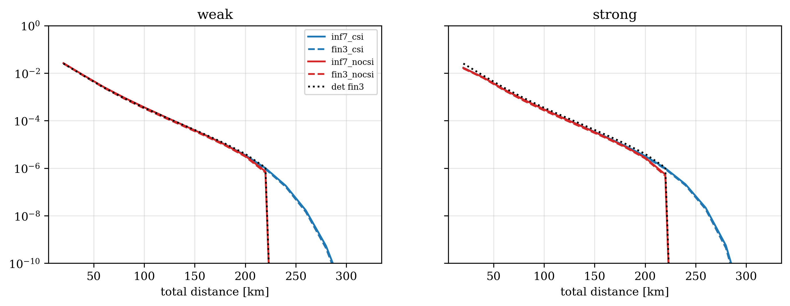

# Finite decoy analysis

This note covers the finite-decoy extension in `paper_analysis/gamma_gamma/`. It answers one question: how much key rate is lost
when the photon-number yields in the phase-error bound are not known exactly but are bounded from a **finite set of decoy
intensities**.

**What this is not.** It is not a finite-key (finite block size) analysis. The key rate is still asymptotic in the number of
pulses. There are no statistical fluctuation terms, no composable security parameter and no data-size dependence anywhere in the
repository.

## 1. Where the yields enter

The Z-basis error bound `e_Z` is a sum over photon-number pairs `(n_A, n_B)` of the yield `Y_{nA,nB}(eta)` times a coefficient that
depends on the amplitude `alpha`, plus a residual `Delta_j` for the pairs that are left out (CAL Eq. 22, `src/legacy_baseline.py`;
see the v2.4.1 entry in `CHANGELOG.md`). With an infinite number of decoy intensities the yields are known exactly, and the code uses
`yield_exact(nA, nB, eta)` from `tfqkd_ext.py`. That is the baseline everywhere else in the repository.

## 2. Finite decoy bound

With a finite decoy set, the legitimate parties observe only the gains `Q(lambda_A, lambda_B)` for intensities
`lambda_A, lambda_B` in the decoy set. Each gain is a Poisson-weighted sum of yields:

`Q(lambda_A, lambda_B) = sum_{nA,nB} P(nA | lambda_A) P(nB | lambda_B) Y_{nA,nB}`.

`lp_upper_bounds` in `tfqkd_ext.py` (CAL Eq. 26) bounds each yield that `e_Z` needs by solving one linear program per target pair:

- unknowns are `Y_{nA,nB}` for `0 <= nA, nB <= M`, with `M = 10`, each constrained to `[0, 1]`;
- for every decoy pair the gain constraint is `Q - tau <= sum a_{nA,nB} Y_{nA,nB} <= Q`, where `a` are the Poisson weights and
  `tau = 1 - sum a` is the probability mass above `M` photons;
- the objective is to maximise the target yield, solved with SciPy's HiGHS (`scipy.optimize.linprog`);
- the observed gains come from the channel model, `observed_gains(eta, decoys)` (`legacy_baseline.p_zz_beta` at amplitudes
  `sqrt(lambda)`), so they are expectations without statistical noise.

The targets are the seven yields of the CAL bound (`S_CAL7`) plus `(0,4)` and `(4,0)` (`ALL_TARGETS`).

## 3. Using it under fading

- **CSI averaging:** the bound is evaluated per transmittance realisation. `YieldTable(decoys, n)` precomputes the LP bounds on a
  log-eta grid and interpolates `log Y`, so the key rate `E[R(eta)]` stays a plain quadrature sum. The default grid has 170
  points; the ablation script uses 300.
- **No-CSI averaging:** only averaged observables exist, so the gains themselves are averaged over the fading nodes and one set of
  bounds is computed (`prep_nocsi`).
- `YieldTable` returns the trivial bound 1 for any pair outside `ALL_TARGETS`.

## 4. Decoy sets

`finite_decoy.py` compares four sets (intensities in photons per pulse):

| name | intensities | median LP bound / exact yield |
|---|---|---:|
| D2 | 0, 0.1 | 11.06 |
| **D3 (default, `DEC3`)** | 0, 0.001, 0.1 | 1.088 |
| D4 | 0, 0.001, 0.1, 0.3 | 1.075 |
| D5 | 0, 0.001, 0.01, 0.1, 0.5 | 1.022 |

The ratio is the median over target pairs and over 20, 40, 60 and 80 dB loss
(`paper_analysis/gamma_gamma/results/tables/finite_decoy_yield_tightness.csv`). A ratio of 1 means the bound is exact. Individual bounds can be much looser
than the median: with D3 the worst pair reaches a factor of about 625 at 80 dB.

## 5. What it costs

Maximum range, amplitude optimised, key rate above 1e-9 bit/pulse
(`finite_decoy_det_ranges.json`, `master_ranges.json`):

| setting | infinite decoy | finite decoy (D3) |
|---|---:|---:|
| Deterministic channel, no beam broadening | 254.0 km | 237.3 km |
| Gamma-Gamma, CSI, weak / moderate / strong, no beam broadening | 293.4 / 294.8 / 293.4 km | 275.8 / 277.9 / 276.4 km |
| Gamma-Gamma, CSI, weak / moderate, with beam broadening | 289.5 / 199.8 km | 272.3 / 187.0 km |
| Gamma-Gamma, no CSI, weak, no beam broadening | 248.2 km | 231.9 km |

Most of the loss comes from restricting the bound to the seven CAL yields, not from the decoy bound itself. In the deterministic
case the infinite-decoy range with the seven-yield set is 238.2 km, against 237.3 km for D3, so D3 costs about 1 km on top of that.
Increasing the decoy count helps little in this model: D4 reaches 237.6 km, and D5 is lower (222.8 km) in the deterministic
comparison.

With a fixed amplitude the finite-decoy range drops much further (deterministic, fixed `alpha = 0.2`: 187.9 km), so optimise
`alpha` whenever the finite decoy bound is used.



`gg_F7_finite_decoy_gg` (weak and strong turbulence) shows the three-intensity curves lying almost on top of the seven-yield
infinite-decoy curves, with and without CSI. The large gap in range is between CSI and no CSI, not between finite and infinite decoy.

## 6. Reproduce

```bash
python paper_analysis/gamma_gamma/finite_decoy.py     # tightness, deterministic comparison, Gamma-Gamma
python paper_analysis/gamma_gamma/master_table.py     # master table and ranges (see its README)
```

The ablation study (`docs/ABLATION.md`) includes the variant "Finite decoy (3 intensities, LP)".

## 7. Limits

- No finite-key statistics: gains are noise-free expectations and the number of pulses does not appear.
- The `finT` rows in `finite_decoy_det_ranges.json` (finite decoy with the triangular set) are not used here: their curves in
  `gg_F6_finite_decoy_det.png` show drop-outs between roughly 18 and 76 dB, which I did not trace. Pairs outside the LP targets get
  the trivial yield bound 1, which may be the cause.
- Photon numbers are truncated at `M = 10` in the LP, with the tail mass `tau` carried in the constraints.
- The interpolated yield tables are not validated separately against the direct LP beyond the tightness table above.
- Amplitude imbalance between the arms and pointing jitter are not modelled (`paper_analysis/gamma_gamma/README.md`).
